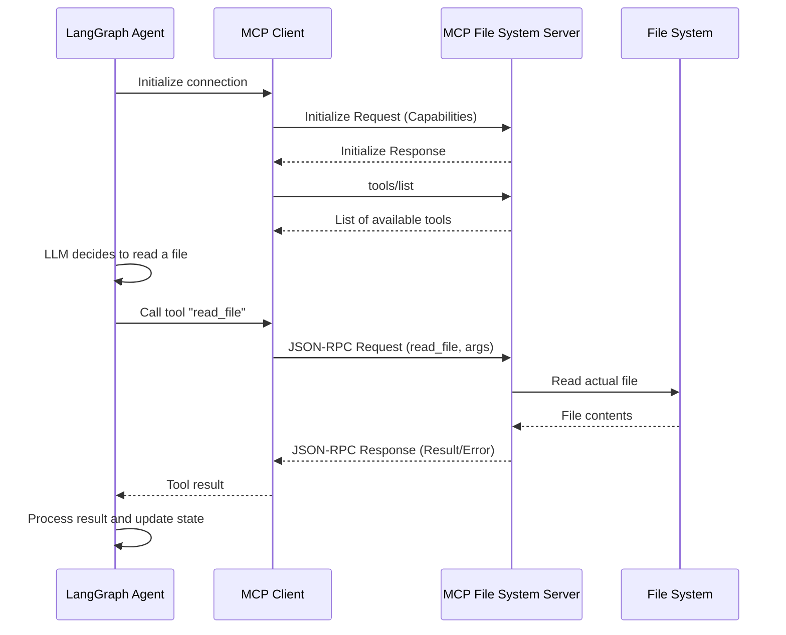

# Architecture Reference: MCP Integration

This document outlines the architecture for integrating the Model Context Protocol (MCP) into the existing agent workflow, based on the requirements in `ProblemStatement.md`.

## 1. System Overview

The primary architectural shift is **decoupling** the LangGraph agent from direct file system operations. Instead of the agent calling local file system tools directly, it will communicate with an independent **MCP File System Server** using a standardized JSON-RPC 2.0 protocol. This creates a scalable, modular architecture where capabilities can be easily discovered, isolated, and utilized securely.

```mermaid
graph LR
    A[LangGraph Agent\n(matching_agent.py)] <-->|JSON-RPC 2.0\nover stdio / HTTP| B[MCP File System Server\n(filesystem_mcp_server.py)]
    B <--> C[(Local File System)]
    
    subgraph "Bonus: Multi-MCP"
        A <--> D[Web Search MCP Server]
        A <--> E[Database MCP Server]
    end
```

## 2. Core Components

### 2.1. MCP File System Server (`filesystem_mcp_server.py`)
This is a standalone service responsible for executing file system operations and exposing them as MCP resources and tools.

*   **Protocol:** JSON-RPC 2.0 compliant.
*   **Key Responsibilities:**
    *   **Resource Discovery:** Expose available files and directories as discoverable resources to the agent.
    *   **Tool Execution:** Handle requests for file operations (read, write, list, etc.) that were previously implemented as direct Python functions in Milestone 1.
    *   **Advanced Capabilities:**
        *   `watch_directory()`: Implement a mechanism to monitor a directory for new resumes (e.g., utilizing MCP's resource templates or custom tools).
        *   `batch_process()`: Allow the client to send multiple file processing operations efficiently in a single request/tool call.
    *   **Error Handling:** Return standard JSON-RPC error codes and structured error messages when file operations fail.
    *   **Configuration Management:** Manage server settings, such as defining allowed base directories to prevent unauthorized access to the host system.

### 2.2. LangGraph Agent (`matching_agent.py`)
The main application logic, which now acts as an **MCP Client**.

*   **Key Responsibilities:**
    *   Maintain existing reasoning, state management, and workflow capabilities.
    *   **MCP Client Integration:** Connect to the `filesystem_mcp_server` to discover available resources and tools dynamically.
    *   **Tool Invocation:** Translate the LLM's tool calls into JSON-RPC requests directed to the MCP server.
    *   **Response Processing:** Parse and utilize the responses from the MCP server to continue the workflow execution.

## 3. Workflow & State Machine

The interaction between the agent and the MCP server follows a request-response lifecycle, driven by the LLM's reasoning process and graph state.



## 4. Implementation Steps

1.  **Develop the MCP Server (`filesystem_mcp_server.py`)**
    *   Set up a basic MCP server using a Python MCP SDK (e.g., `@modelcontextprotocol/sdk` or similar Python equivalent).
    *   Migrate Milestone 1 functions into the server as registered `@server.tool()` endpoints.
    *   Implement resource templates for file discovery.
    *   Implement `watch_directory()` and `batch_process()`.

2.  **Refactor the Agent (`matching_agent.py`)**
    *   Remove custom local file system tools.
    *   Instantiate an MCP Client.
    *   Connect the client to the newly created server (typically via `stdio` using a subprocess for local servers).
    *   Fetch tools from the server and bind them to the LangGraph LLM node dynamically.

3.  **Bonus: Multi-MCP Integration**
    *   Instantiate additional MCP clients for web search or database servers.
    *   Combine the tool sets from all servers and provide them simultaneously to the agent.
